# FPS 大厅创建流程

配套图：`Docs/Images/FPSLobbyFlow.png`（由 `Saved/DiagramGen/RenderFPSLobbyFlow.py` 用 Pillow 绘制，
`python Saved/DiagramGen/RenderFPSLobbyFlow.py` 可重新生成）。

一句话概括：**大厅是一个本地前端世界（`/Engine/Maps/Entry` + `FPSLobbyMode`），它本身不开监听；
只有房主点「创建局域网房间」触发的 `listen` 跳转才让世界"可被加入"，客户端随后连上，
并靠复制过来的 GameState 在本地自己搭出同一套菜单。**

## 流程图（Mermaid 源码，可在支持 Mermaid 的编辑器/GitHub 渲染）

```mermaid
flowchart TD
  subgraph P1["① 启动 → 本地大厅世界（单机 / 房主进程）"]
    n01["01 启动游戏 Tools/LaunchFPSDemo.ps1<br/>地图固定 /Engine/Maps/Entry<br/>GlobalDefaultGameMode=FPSLobbyMode"]
    n02["02 实例化 AFPSLobbyMode（AGameModeBase）<br/>GameStateClass=AFPSLobbyState<br/>PlayerControllerClass=AFPSFrontController<br/>DefaultPawnClass=无，bStartPlayersAsSpectators=true"]
    n03["03 AFPSFrontController::BeginPlay 绑定菜单键<br/>运行时创建 UInputAction + InputMappingContext，Esc，优先级 20"]
    n04["04 Tick → RefreshMenu() 判定是否显示菜单<br/>bWaiting = IsLobby() 或 bWaiting 或 bFinished"]
    d05{"05 bWaiting 成立且 Menu 尚未创建？"}
    b05["不创建，保持现状<br/>客户端这一帧可能还没收到复制的 GameState"]
    d06{"06 LocalPlayer / GameViewport 已就绪？"}
    b06["ShowMenu 直接 return<br/>构建只能挂在 Tick 上重试"]
    n07["07 ShowMenu() 构建原生 Slate 菜单<br/>SBorder → SBox(900) → SScrollBox → SVerticalBox<br/>AddViewportWidgetForPlayer(50) + 鼠标/GameAndUI"]
    n08["08 大厅分支按钮<br/>单机人机 0–9 / 进入靶场 / 房间名≤24 / 创建局域网房间 / 加入房间 IPv4"]
    n01 --> n02 --> n03 --> n04 --> d05
    d05 -->|是| d06
    d05 -->|否| b05
    d06 -->|是| n07
    d06 -->|否| b06
    n07 --> n08
  end

  subgraph P2["② 创建局域网房间（唯一让世界可被加入的服务端动作）"]
    n09["09 点击「创建局域网房间」<br/>房间名 Trim → 截断 24 字符 → URL 敏感字符替换为 _"]
    n10["10 Travel('listen?Mode=LAN?Room=＜名称＞')<br/>OpenLevel(LV_NetSyncFPS?game=FPSMatchMode?listen?Mode=LAN?Room=…)"]
    n11["11 服务器 LoadMap → AFPSMatchMode::InitGame<br/>解析 Mode（LAN/Training，其它回落 Solo）、Bots clamp 0–9、Room 截 24"]
    n12["12 InitGameState() 写入复制状态<br/>bStructuredMatch=1，bWaiting=(Mode==LAN)=1，RoomName=…"]
    n13["13 此刻世界才 listen，等待房间菜单生成<br/>切换阵营 / 开始对局（仅房主）/ 返回大厅"]
    n08 --> n09 --> n10 --> n11 --> n12 --> n13
  end

  subgraph P3["③ 客户端加入 → 准入 → 自动分队"]
    n14["14 输入房主 IPv4 →「加入房间」<br/>IsValidAddress 校验 → ClientTravel(TRAVEL_Absolute)"]
    d15{"15 PreLogin 准入通过？"}
    b15["拒绝连接<br/>非 LAN 模式 / 满 10 人 / 已结算"]
    d16{"16 InitNewPlayer 复查通过？"}
    b16["拒绝（准入不通过）<br/>两队各满 5 人 / 请求旁观位"]
    n17["17 自动分队 + 暂不生成角色<br/>TeamId = TeamSize(0) &lt;= TeamSize(1) ? 0 : 1<br/>bWaiting 为真 → 不生成 Pawn"]
    n18["18 GameState 复制到达 → 客户端本地自建同一套菜单<br/>客户端没有 GameMode（auth-mode=0）<br/>只有 切换阵营 / 继续游戏 / 返回大厅"]
    n13 -.->|客户端加入| n14
    n14 --> d15
    d15 -->|是| d16
    d15 -->|否| b15
    d16 -->|是| n17
    d16 -->|否| b16
    n17 --> n18
  end

  subgraph P4["④ 开局 → 结算 → 返回大厅"]
    d19{"19 房主 ServerStartRound 被接受？"}
    b19["直接忽略<br/>IsLocalController=false 或某一队 0 人"]
    n20["20 bWaiting=false，RoundEndsAt=+300s，全员 RestartPlayer<br/>蓝队 x=-1650 / 红队 x=+1650，通道位 = PlayerId 取模 5"]
    n21["21 300s 到点或提前 FinishRound → 前三名快照<br/>bFinished=true，分数↓ / 死亡↑ / PlayerId↑ 取前 3"]
    n22["22「返回大厅」OpenLevel(/Engine/Maps/Entry, game=FPSLobbyMode)<br/>房主返回即关闭房间；失败信息经 ConnectionError 跨关卡显示"]
    n18 -.->|房主开始| d19
    d19 -->|是| n20
    d19 -->|否| b19
    n20 --> n21 --> n22
  end
```

## 节点 → 代码位置

| 节点 | 位置 |
| --- | --- |
| 01 默认地图与默认规则 | `Config/DefaultEngine.ini:4-7`、`Tools/LaunchFPSDemo.ps1:6` |
| 02 `AFPSLobbyMode` 构造 | `Source/MCP_Test/FPSMatchFlow.cpp:13-19` |
| 03 Esc 菜单键 | `Source/MCP_Test/FPSFrontController.cpp:50-63` |
| 04 菜单可见性判定 | `FPSFrontController.cpp:93-105`、`:24-27`（`IsLobby`） |
| 05 未就绪时等下一帧 | `FPSFrontController.cpp:103-104` |
| 06 视口未就绪则 return | `FPSFrontController.cpp:171` |
| 07 Slate 树与视口挂载 | `FPSFrontController.cpp:239-249` |
| 08 大厅按钮分支 | `FPSFrontController.cpp:186-219` |
| 09 房间名清洗 | `FPSFrontController.cpp:201-207`（`:204` 是字符替换） |
| 10 `Travel` / `OpenLevel` | `FPSFrontController.cpp:133-139` |
| 11 `InitGame` 解析 URL | `FPSMatchFlow.cpp:26-34` |
| 12 `InitGameState` 写复制状态 | `FPSMatchFlow.cpp:36-44`、`FPSDemoGameState.h:22-29` |
| 13 等待房间菜单 | `FPSFrontController.cpp:220-236` |
| 14 地址校验与 `ClientTravel` | `FPSFrontController.cpp:29-47`、`:210-218` |
| 15 `PreLogin` 门禁 | `FPSMatchFlow.cpp:65-72` |
| 16 `InitNewPlayer` 复查 | `FPSMatchFlow.cpp:83-97` |
| 17 自动分队与不生成 Pawn | `FPSMatchFlow.cpp:91-95`、`:99-103` |
| 18 客户端靠复制状态自建菜单 | `FPSFrontController.cpp:97`、`:103-104`；日志 `auth-mode=0` |
| 19 开局权限 | `FPSMatchFlow.cpp:140-144` |
| 20 开局与出生点 | `FPSMatchFlow.cpp:145-150`、`:105-114` |
| 21 结算与前三名 | `FPSMatchFlow.cpp:153-178`、`FPSDemoGameState.h:29` |
| 22 返回大厅与失败提示 | `FPSFrontController.cpp:230-235`、`FPSFrontGameInstance.cpp:18-28` |

## 回归检查

`Tools/TestFPSLobby.ps1`（服务端带 `?listen` 且保持空闲）验证的是上图 01–10 段：
客户端加入后应在数十毫秒内出现 `FPS_LOBBY_SMOKE PASS menu-ready role=CLIENT auth-mode=0`，
日志在 `Saved/FPSFlowTests/LobbyIdle-*.log`。
